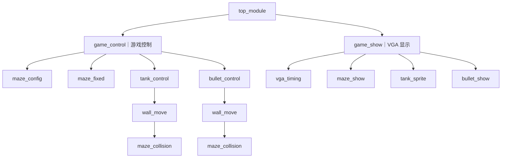

# FPGA 坦克动荡

这是一个运行在 Basys3 上的单坦克迷宫小游戏，使用 Verilog 编写，并通过 VGA 输出 640×480 画面。当前版本支持三档地图、坦克移动与挡墙、发射子弹和子弹反弹。

## 一、模块结构

系统以 [`top_module`](top.v) 为顶层。**控制侧决定游戏状态，显示侧把状态转换成 VGA 像素。** 顶层负责板级输入输出和两侧的连线。

### 1. 模块实例层级

实线表示「上层模块实例化下层模块」。坦克和子弹复用同一份分轴移动和碰撞查询源码，各自有一套硬件实例。

### 2. 控制与显示之间的信号流

1. **复位选图。** 控制侧锁存随机样本。`maze_config` 选地图档位，`maze_fixed` 用同一个档位输出对应的墙位。控制侧用墙位判断碰撞，显示侧用同一份墙位画墙。 [`game_control.v`](game_control.v) · [`maze_config.v`](maze_config.v) · [`maze_fixed.v`](maze_fixed.v)
2. **每帧更新状态。** 显示侧的 `vga_timing` 产生 `frame_tick`。控制侧收到脉冲后开始更新坦克和子弹，使用 `wall_move` 分轴试走、用 `maze_collision` 查墙。子弹发射时读取坦克中心和朝向对应的速度分量。 [`tank_control.v`](tank_control.v) · [`bullet_control.v`](bullet_control.v) · [`wall_move.v`](wall_move.v) · [`maze_collision.v`](maze_collision.v)
3. **逐像素合成画面。** `vga_timing` 把扫描坐标送给墙、坦克和子弹绘制模块。`game_show` 在可见区按坦克、墙、子弹、地面的优先级选择颜色，消隐区输出黑色。 [`vga_timing.v`](vga_timing.v) · [`game_show.v`](game_show.v) · [`maze_show.v`](maze_show.v) · [`tank_sprite.v`](tank_sprite.v) · [`bullet_show.v`](bullet_show.v)

[`param.vh`](param.vh) 是公共参数头文件，[`tank.mem`](tank.mem) 是坦克贴图 ROM 数据。`maze_gen.v` 和 `seg7_hex.v` 分别预留给随机墙布局和数码管显示。

## 二、操作方式

| 输入 | 功能 |
| --- | --- |
| 上、下键 | 沿坦克当前朝向前进、后退 |
| 左、右键 | 旋转坦克 |
| 中心键 `BTN_C` | 点按发射一颗子弹。重新发射前需松开按键 |
| `SW15` | 拨上复位并抽取地图，拨下开始游戏 |

上电默认使用大地图。每次进入复位时锁存一次 LFSR 的伪随机样本，以此选择一套固定墙布局。地图配置在本局中保持稳定，连续两次复位可能选中同一档。

| 地图 | 格子数 | 格子边长 | 墙厚 | 坦克贴图 | 坦克速度 | 子弹半径 |
| --- | ---: | ---: | ---: | ---: | ---: | ---: |
| 大 | 12×9 | 48 px | 4 px | 32×32 px | 1.5 px/帧 | 3 px |
| 中 | 8×6 | 72 px | 6 px | 48×48 px | 2.25 px/帧 | 5 px |
| 小 | 6×4 | 96 px | 8 px | 64×64 px | 3 px/帧 | 6 px |

每颗子弹从坦克中心沿当前朝向发射，初速是同档坦克的两倍。场上最多同时存在 5 颗子弹，每颗存活 480 帧，约 8 秒。当前已实现子弹与墙的交互。子弹命中坦克、双人对战和计分属于后续开发内容。

## 三、关键实现

- **墙位是渲染和碰撞的共同依据。** 每个格子有一位右墙和一位下墙。三档地图都用 `row * 12 + col` 编号。绘墙时判断像素是否落在墙带，碰撞时判断整个碰撞盒是否覆盖墙带。
- **坦克与子弹共用分轴碰撞。** 先试 X，再用接受后的 X 试 Y。坦克在受阻的轴上保留原坐标，因此能沿墙滑动。子弹在受阻的轴上反转速度分量。
- **用定点数保存亚像素位移。** `FRAC_BITS = 6`，位置寄存器中 64 个单位代表 1 像素。显示取整数像素坐标，状态更新继续保留小数部分。

## 四、验证记录

| 检查 | 已取得的结果 |
| --- | --- |
| 墙壁碰撞 | 对三档地图做了 1,272 次碰撞盒与逐像素参考判断的比对，另验证了贴墙滑动和墙角阻挡 |
| 子弹控制 | 仿真通过横向和纵向反弹、长按单次发射、五发上限与到期回收 |
| 顶层输出 | 仿真确认从 `BTN_C` 到 VGA 子弹像素的完整链路 |
| FPGA 实现 | Vivado 2019.1 布线后满足 100 MHz 约束，最差建立时间余量为 +0.844 ns |

仓库保存原工程 `sources_1/new` 中的设计源码。用 Vivado 重建时，将 `top_module` 设为综合顶层，加入 `tank.mem`，并使用原工程的 Basys3 引脚约束。
