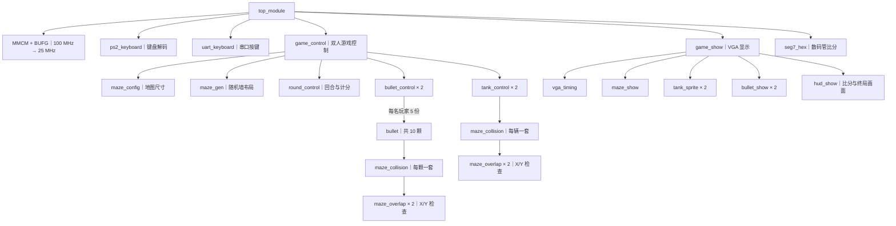

# FPGA 坦克动荡

运行在 Basys3 上的双人坦克迷宫对战游戏，使用 Verilog 实现，通过 VGA 输出 640×480 画面。当前支持随机迷宫、双人键盘操作、墙壁碰撞与子弹反弹、命中计分、自动换图，以及先得 5 分的比赛规则。

仓库根目录对应原 Vivado 工程的 `tank_battle.srcs/sources_1/new`，包含设计源码与坦克贴图数据。

## 一、操作与游戏规则

### 1. 双人操作

| 动作 | 玩家 1（红方） | 玩家 2（蓝方） | 板上按键（控制红方） |
| --- | --- | --- | --- |
| 沿当前朝向前进 | W | ↑ | BTN_U |
| 沿当前朝向后退 | S | ↓ | BTN_D |
| 左转 | A | ← | BTN_L |
| 右转 | D | → | BTN_R |
| 开火 | Space | Enter | BTN_C |

前进、后退沿坦克朝向移动，左右键用于旋转。开火在帧边界检测按下沿，按住只发一颗，再次发射需要先松开。

已上板验证的输入方式是把键盘接到电脑，再用 Basys3 的 J4 Micro USB 串口发送双方按键状态。J2 USB-A 的接收逻辑使用 [`ps2_keyboard.v`](ps2_keyboard.v) 解码 PS/2 Set 2 扫描码，已用测试波形验证。上板排查时没有检测到 J2 的 PS/2 时钟，双人演示使用 J4。两路按键状态在顶层合并，板上五向按键额外并入红方输入。

| 开关 | 功能 |
| --- | --- |
| SW15 | 高电平复位并清空比分；拨下后开始比赛。再次拨上会重新抽取地图档位与种子 |
| SW14 | 打开键盘和串口诊断 LED |

### 2. 回合与胜负

- 红方出生在左上角格心，初始朝下；蓝方出生在右下角格心，初始朝上。
- 任意一方被子弹命中，对方得 1 分。本回合结束，存活坦克与子弹的位置暂停更新。
- 双方在同一个判定帧被命中时，本回合平局，双方都不加分。
- 未决出比赛胜者时，等待 120 帧（约 2 秒），自动生成下一回合地图并重置双方坦克、子弹。
- 新回合从另外两档地图尺寸中抽取一档，保证相邻回合的地图档位不同。
- 先得 5 分的一方获胜，显示 `P1 WINS` 或 `P2 WINS`、最终比分和 `SW15 RESET` 提示，等待复位重新开始。

命中采用轴对齐碰撞盒重叠判定。子弹刚发射时忽略与发射者的重叠，第一次离开碰撞盒后，返回便可以击中自己。自击也按被击毁方的对手得分处理。

VGA 顶部状态栏显示双方比分；板载数码管最左位显示红方得分，最右位显示蓝方得分，中间两位关闭。

### 3. 子弹规则

每名玩家有 5 个独立子弹槽，全场最多同时存在 10 颗子弹。点按开火时分配编号最小的空闲槽，槽位已满时本次发射不生效。子弹从坦克中心沿当前朝向发射，初速为同档坦克前进速度的两倍，撞墙后反转受阻轴的速度分量。

每颗子弹存活 480 个物理更新帧，连续对战时约 8 秒，到期后回收槽位；回合切换会统一清空子弹。

## 二、地图配置与随机生成

### 1. 三档尺寸

| 地图 | 模式 | 列×行 | 格子边长 | 墙厚 | 坦克贴图 | 坦克轴向速度 | 子弹半径 | 额外拆墙 |
| --- | ---: | ---: | ---: | ---: | ---: | ---: | ---: | ---: |
| 大 | 0 | 12×9 | 48 px | 4 px | 32×32 px | 1.5 px/帧 | 3 px | 4～11 面 |
| 中 | 1 | 8×6 | 72 px | 6 px | 48×48 px | 2.25 px/帧 | 5 px | 2～5 面 |
| 小 | 2 | 6×4 | 96 px | 8 px | 64×64 px | 3 px/帧 | 6 px | 1～2 面 |

三档地图宽度均为 576 px，左边界为 x=32。大、中地图高 432 px、上边界 y=40；小地图高 384 px、上边界 y=64。画面顶部保留 32 px 状态栏。

上电默认使用大地图。开始新比赛时，[`maze_config.v`](maze_config.v) 按 LFSR 样本划分的三个等长区间选择档位；后续回合在当前档位之外二选一。档位相同的不同比赛也会依据种子重新生成墙布局。

### 2. DFS 连通迷宫与额外环路

实际墙布局由 [`maze_gen.v`](maze_gen.v) 生成，流程如下：

1. **初始化。** 全部墙位置 1，从左上角 `(0,0)` 出发，仅标记起点已访问。
2. **深度优先搜索。** 检查四邻格的边界和访问标记，选一个未访问邻格，保存当前坐标到回溯栈，拆开共用墙并进入邻格。没有新格可走时弹栈回退。
3. **完成连通。** 无邻格可走且栈空时结束 DFS。N 个格子通过 N−1 条通路连成生成树，全图连通且没有环路。
4. **增加环路。** 按地图大小确定额外拆墙数。随机选择一个扫描起点，只拆仍关闭的内墙；当前格没有目标时按行循环扫描。每额外拆一面墙，就增加一个独立环路，提供绕行路线。
5. **提交地图。** 在 `PUBLISH` 状态一次性更新两组输出墙位，完成后释放 `busy`。

状态转换为 `IDLE → SEARCH → PICK → REMOVE → PUBLISH → IDLE`；需要继续拆墙时从 `REMOVE` 返回 `PICK`，找不到当前格可拆的墙时留在 `REMOVE` 扫描下一格。

随机数采用 16 位 LFSR。DFS 的方向选择是随机确定起始方向，再按“右、下、左、上”的循环顺序取第一个可走方向，具有方向偏向，不保证所有迷宫等概率生成。

额外拆墙的扫描起点采用**拒绝采样**：随机行、列都在有效范围内才接受，任一越界就留在 `PICK`，等待下一拍的新候选值。这样避免把越界值集中映射到第 0 行、列。最终拆墙位置还受闭墙分布和顺序扫描影响，不等同于对全部内墙均匀抽样。

地图生成时只修改 `next_right`、`next_bottom`，完成前保留上次提交的输出墙位。控制侧在换图期间保持坦克和子弹复位，并暂停物理更新，完成后才开始新回合。相同种子与配置可复现布局；算法保证连通，但没有单独约束出生点距离、对称性或路线公平性。

### 3. 墙位存储

[`maze_show.v`](maze_show.v) 和 [`maze_collision.v`](maze_collision.v) 共用生成器输出的墙位：

- `right_walls[107:0]` 保存每格右墙，`bottom_walls[107:0]` 保存每格下墙；1 表示有墙，0 表示通路。
- 编号统一为 `index = row * 12 + col`，小地图也使用 12 格的存储跨度。
- 左墙读取左邻格的右墙，上墙读取上邻格的下墙；最左、最上外围边界单独处理，右、下外围墙在生成时保持封闭。

[`maze_fixed.v`](maze_fixed.v) 保留了旧的固定墙布局，当前游戏控制链路使用 `maze_gen`。

## 三、模块结构

系统以 [`top_module`](top.v) 为顶层。控制侧计算坐标、命中和比分，显示侧根据扫描坐标合成像素。顶层用 `MMCME2_BASE` 和 `BUFG` 将板载 100 MHz 转为整个游戏使用的 **25 MHz** 工作时钟。MMCM 锁定且 SW15 拨下后释放复位，VGA 每拍扫描一个像素。



`ps2_keyboard` 和 `uart_keyboard` 的按键经顶层合并后送入控制侧。控制侧将墙位、坦克和子弹坐标及比分送往显示侧，`vga_timing` 每帧送回一个 `frame_tick`。对战时坦克和子弹直接在该帧脉冲更新，回合等待和地图生成期间暂停。显示优先级依次为状态栏或终局覆盖层、红方坦克、蓝方坦克、墙、子弹和地面，消隐区输出黑色。

| 文件 | 职责 |
| --- | --- |
| [`top.v`](top.v) | `top_module` 顶层，负责时钟、复位、输入合并、数码管比分和诊断 LED |
| [`game_control.v`](game_control.v) | 地图生成调度、双方实体实例化、出生点、子弹命中与自击判定 |
| [`round_control.v`](round_control.v) | 回合状态、计分、120 帧等待、先得 5 分的胜负控制 |
| [`maze_config.v`](maze_config.v) | 地图档位选择及像素尺寸、贴图缩放配置 |
| [`maze_gen.v`](maze_gen.v) | DFS、显式回溯栈、额外拆墙和完整墙位提交 |
| [`maze_fixed.v`](maze_fixed.v) | 旧版固定布局数据，当前未接入游戏控制 |
| [`maze_collision.v`](maze_collision.v) | `maze_collision` 与 `maze_overlap`，组合逻辑分轴碰撞 |
| [`tank_control.v`](tank_control.v) | 坦克朝向、定点坐标、按键移动和挡墙 |
| [`bullet_control.v`](bullet_control.v) | 开火按下沿检测和每名玩家 5 个槽位的发射分配 |
| [`bullet.v`](bullet.v) | 单颗子弹的飞行、分轴反弹、寿命和回收 |
| [`ps2_keyboard.v`](ps2_keyboard.v) | PS/2 帧接收、奇校验、扩展码/松键码和双方按键状态 |
| [`uart_keyboard.v`](uart_keyboard.v) | 115200 波特率串口接收、双玩家状态包和断联松键 |
| [`game_show.v`](game_show.v) | 墙、双方坦克与子弹、HUD 的逐像素合成 |
| [`vga_timing.v`](vga_timing.v) | 扫描计数、行场同步、可见区和帧脉冲 |
| [`maze_show.v`](maze_show.v) | 从墙位计算当前扫描像素是否属于墙壁 |
| [`tank_sprite.v`](tank_sprite.v) | 32 方向坦克贴图查询、缩放与红蓝配色 |
| [`bullet_show.v`](bullet_show.v) | 单名玩家的 5 颗活动子弹绘制 |
| [`hud_show.v`](hud_show.v) | 比分文字、获胜方和复位提示 |
| [`seg7_hex.v`](seg7_hex.v) | 四位数码管扫描，顶层仅启用最左和最右位 |
| [`param.vh`](param.vh) | VGA、地图容量、速度、碰撞半径、子弹上限和比赛规则参数 |
| [`tank.mem`](tank.mem) | 32 个方向、每方向 16×16 的 2 位坦克贴图 ROM 数据 |

## 四、关键实现

### 分轴碰撞与子弹反弹

`maze_collision` 先通过第一路 `maze_overlap` 检查 `(next_x, y)`。X 受阻时保留原 `x`，再通过第二路检查 `(accepted_x, next_y)`。组合逻辑输出 `hit_x`、`hit_y`，实体在帧边界采样结果。坦克在受阻轴保留坐标，子弹还会反转该轴速度，另一轴可以继续运动。

### 坦克命中与出生免伤

`TANK_R = 14` 是坦克撞墙的基础半径，`TANK_HIT_R = 11` 是子弹命中坦克用的基础半径。二者按地图档位缩放。命中判定用缩放后的坦克命中半径加上子弹半径，大、中、小图分别为 **14、21、28 像素**。任一轴的中心距离达到该阈值时，子弹就离开发射者的碰撞盒，`left_owner` 置位。三档地图都仿真验证了出生格上下有墙时，沿初始朝向开火可以解除免伤，并在回弹时击中发射者。

### 定点坐标与并行实体

位置保留 6 位小数，即 64 个单位代表 1 px。坦克用 32 方向位移查表，根据地图档位缩放速度；显示侧只读取整数像素坐标。两辆坦克和 10 颗子弹各自维护状态与查墙逻辑，并行工作。

子弹使用 `IDLE`、`FLYING` 两态，发射时保存位置和速度，飞行期间每个物理更新帧推进位置、反弹和寿命。命中检测由 `game_control` 汇总，`round_control` 在帧边界裁定本回合结果。

### 串口控制协议

[`uart_keyboard.v`](uart_keyboard.v) 用 25 MHz 工作时钟接收 **115200、8N1** 数据，每位约 217 拍。一个完整按键包由以下两个字节组成。

```text
字节 1：101 f r l b u    （0xA0 | 红方按键位）
字节 2：110 f r l b u    （0xC0 | 蓝方按键位）
低五位：bit4=开火，bit3=右转，bit2=左转，bit1=后退，bit0=前进
```

例如仅红方前进发送 `A1 C0`，双方松键发送 `A0 C0`。收齐两个字节后同时更新双方状态，发送端应持续刷新按键包。连续 15 个 VGA 帧没有完整包（约 0.25 秒）时，串口按键自动清零。电脑端发送程序未包含在本源码仓库中。

### LED 诊断

LD15 为心跳，每 60 帧翻转一次；LD14 在 SW14 打开或比赛结束时点亮。SW14 打开后，其他 LED 含义如下，关闭时 LD13～LD0 熄灭：

| LED | 含义 |
| --- | --- |
| LD13 | 曾检测到 PS/2 时钟下降沿，保留到复位 |
| LD12 | 曾收到有效 PS/2 字节，保留到复位 |
| LD11 | 曾发生 PS/2 帧错误或接收超时，保留到复位 |
| LD10 | 当前合并后的 PS/2/串口游戏按键中至少一位按下 |
| LD9 | 曾收到完整串口按键包，保留到复位 |
| LD8 | 串口链路仍在有效收包期内 |
| LD7～LD0 | 最近一个有效 PS/2 扫描码字节 |

## 五、使用与验证

### Vivado 工程重建

1. 使用原 Basys3 工程，或新建对应开发板器件的 Vivado 工程，将仓库中的全部 `.v` 文件和 `param.vh` 加入设计源。
2. 目标器件选 Basys3 的 **`xc7a35tcpg236-1`**。将综合顶层设为 **`top_module`**，并把 `param.vh` 所在目录加入包含路径。
3. 把 `tank.mem` 作为 Memory Initialization File 加入工程，确保 `$readmemh("tank.mem", ...)` 在综合或仿真时能找到该文件。
4. 加入原工程的 Basys3 XDC，给 W5 的板载时钟输入 `clk` 设置 **10 ns** 周期，并约束开关、按键、VGA、数码管、LED、PS/2 和 UART 引脚。Vivado 根据 MMCM 参数自动推导 **40 ns** 的内部工作时钟。
5. 运行综合、实现和比特流生成，通过 Hardware Manager 下载，连接 VGA 显示器与相应输入设备，使用 SW15 复位后开始。

仓库包含设计源码和贴图数据。完整 Vivado 工程、板级 XDC、电脑端串口程序和仿真文件保存在原工程。VGA 每行扫描 800 个像素，每帧 525 行，可见区 640×480，25 MHz 下帧率约 59.52 Hz。

### 验证记录与范围

本地使用 Vivado 2019.1 完成了以下检查。

- **768 组候选坐标**：对三档尺寸各穷举 256 对候选行列，验证合法坐标原样接受、越界坐标重试、采样时 LFSR 继续推进，且不提前提交地图。
- **192 张地图**：每档尺寸使用 64 个种子，检查全图连通、外围封闭、额外开口数及其与抽取目标一致、不同种子产生变化，以及回合切换期间不提交半成品地图、不启用物理更新。
- 上述 192 张样本中最长生成时间为 **320 个时钟周期**，在 25 MHz 下约 12.8 μs。
- **六组出生格回弹测试**。三档地图分别检查红蓝两方，子弹刚发射时免伤，第一次反弹回来后可以击中发射者，对手正常得分。
- **接口仿真**。检查 25 MHz VGA 行场和帧脉冲、115200 波特 UART、PS/2 接收及超时、数码管扫描周期。
- **25 MHz 布线后时序通过**。最新命中半径版本的建立余量 WNS 为 **+6.350 ns**，保持余量 WHS 为 **+0.047 ns**。

早期版本已在 Basys3 上验证 J4 串口控制、数码管比分和 VGA 比分栏。本次 25 MHz 命中半径版本已生成比特流，实物验证待补。
